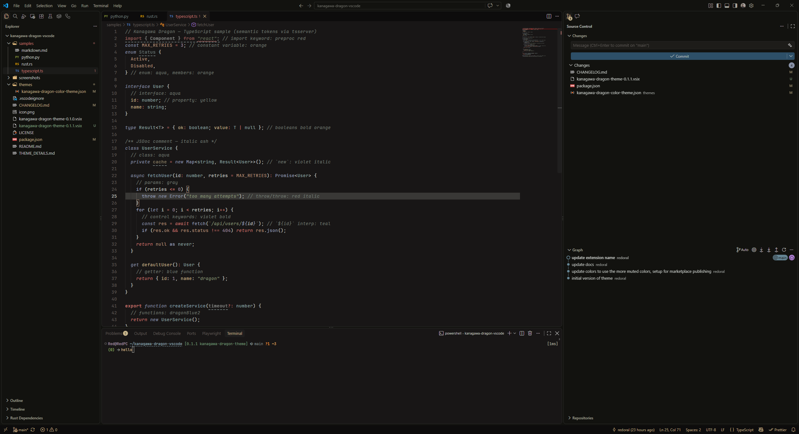
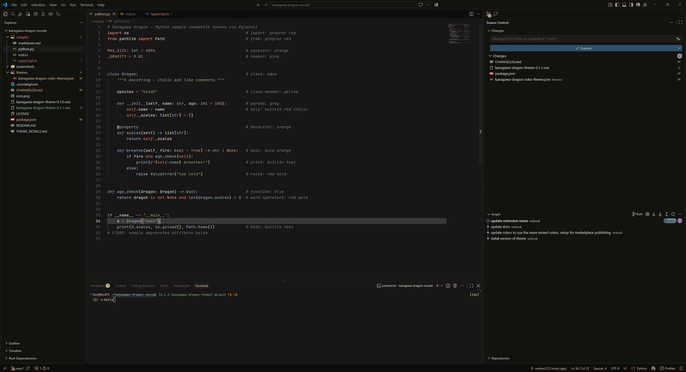
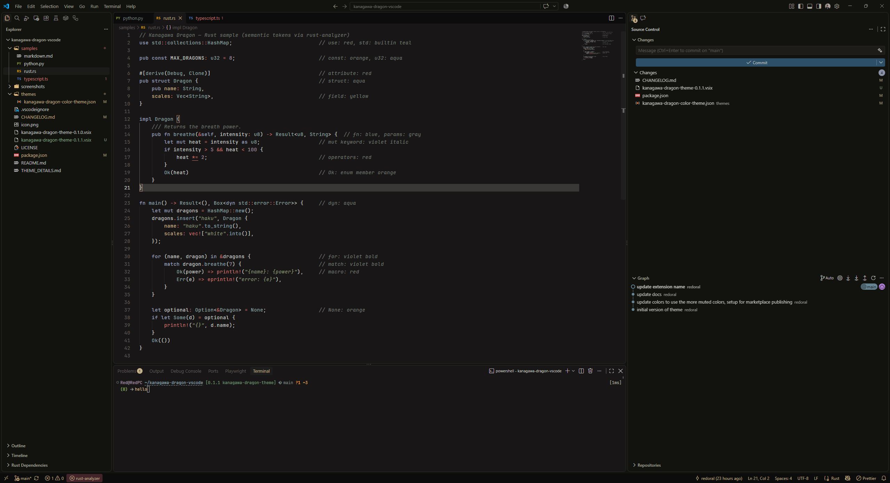
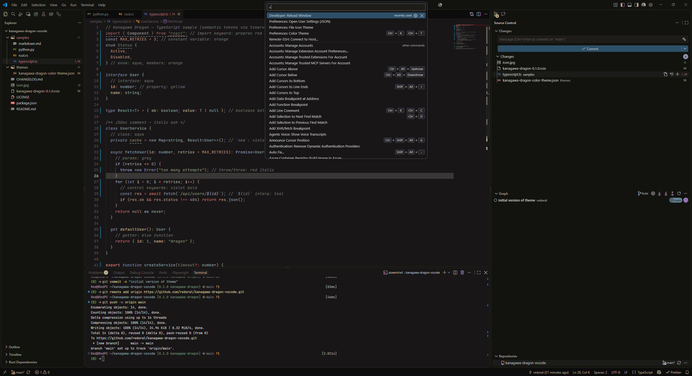

# Kanagawa Dragon Theme for VS Code

A dark, muted port of the **dragon** variant of [kanagawa.nvim](https://github.com/rebelot/kanagawa.nvim) — the palette "for those late-night sessions".

- Original colorscheme: [kanagawa.nvim](https://github.com/rebelot/kanagawa.nvim) by [rebelot](https://github.com/rebelot)
- This port: [redoral/kanagawa-dragon-vscode](https://github.com/redoral/kanagawa-dragon-vscode)

## Screenshots

### TypeScript



### Python



### Rust



### Command palette



## Installation

Search for **Kanagawa Dragon Theme** in the VS Code Extensions view and hit install, or if you are on the repository:

```bash
code --install-extension kanagawa-dragon-theme-0.1.0.vsix
```

Then `Ctrl+K Ctrl+T` → select **Kanagawa Dragon Theme**.

## Details

For the full specifics — syntax color mapping, semantic tokens, workbench colors, and intentional deviations — see [THEME_DETAILS.md](https://github.com/redoral/kanagawa-dragon-vscode/blob/main/THEME_DETAILS.md).

## Credits

This theme is a port of the **dragon** variant of [kanagawa.nvim](https://github.com/rebelot/kanagawa.nvim) — an elegant, dark Neovim colorscheme by [Tommaso (rebelot)](https://github.com/rebelot).

All colors are taken directly from the kanagawa.nvim source. If you enjoy this theme, please go star the original project!

## License

MIT. Colors and design derive from [kanagawa.nvim](https://github.com/rebelot/kanagawa.nvim) © Tommaso (rebelot), MIT licensed.
